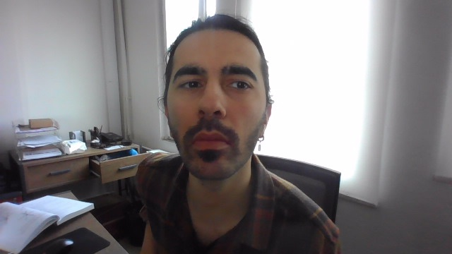
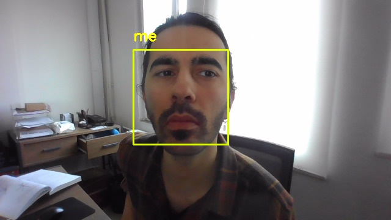

# Yüz Tespiti ve Tanıma

[English](README.md) | **Türkçe**

Python ile yüz tespiti ve tanıma. `face_recognition` (dlib) ve OpenCV ile yazıldı. Yüz kaydı, resimden ve canlı kameradan tanıma, ayrıca yüz bulanıklaştırma içerir.

## Projenin yapısı
- `dataset/`: kayıt resimleri. Her kişi için bir alt klasör var (örneğin `dataset/me/image_0.jpg`). Klasör adı, kişinin etiketi olur.
- `capture_images.py`: kameradan resim çekip `dataset/<isim>/` altına kaydeder.
- `train_model.py`: `dataset/` içindeki yüzleri kodlayıp `encodings.pickle` dosyasına kaydeder.
- `recognize_from_image.py`: `test_resmi.jpg` içindeki yüzleri tanır, sonucu `output.jpg` olarak yazar.
- `recognize_from_camera.py`: kameradan gerçek zamanlı tanıma yapar.
- `redact_image.py`: bulduğu her yüzü bulanıklaştırır ve sonucu ölçer.
- `haarcascade_frontalface_default.xml`: `redact_image.py`'nin kullandığı OpenCV Haar cascade dosyası.
- `test_resmi.jpg`, `output.jpg`, `redacted.jpg`: test resmi, tanıma çıktısı ve bulanıklaştırma çıktısı.
- `encodings.pickle`: kayıtlı yüzlerin özellik vektörleri.

## Gereksinimler
```
pip install face_recognition opencv-python imutils numpy
```
`face_recognition` dlib'e bağlıdır. Windows'ta dlib için CMake ve bir C++ derleyicisi gerekir.

## Kameradan kayıt resmi toplama: `capture_images.py`
Kamerayı açar. Space tuşu kareyi `dataset/<isim>/image_X.jpg` olarak kaydeder, Esc çıkar.
```
python capture_images.py
```

## Kodlama: `train_model.py`
`dataset/` klasörünü tarar, HOG detektörüyle yüzleri bulur, her yüz için 128 boyutlu bir özellik vektörü hesaplar ve hepsini `encodings.pickle` dosyasına yazar. Okunamayan, yüz bulunmayan ya da kodlanamayan resimler uyarı verilerek atlanır.
```
python train_model.py
```

## Resimden tanıma: `recognize_from_image.py`
`test_resmi.jpg` dosyasını okur, her yüzü `encodings.pickle` ile karşılaştırır, tanınan yüzü sarı kutu ve isimle işaretler, sonucu `output.jpg` olarak kaydeder.
```
python recognize_from_image.py
```

| Girdi | Çıktı |
|---|---|
|  |  |

## Canlı tanıma: `recognize_from_camera.py`
Kamerayı açar ve her karede yüzleri tanır. `q` tuşu kapatır.
```
python recognize_from_camera.py
```

## Yüz bulanıklaştırma: `redact_image.py`
Haar cascade ile yüzleri bulur, her kutuyu her yönden %10 büyütür, 8x8 bloğa indirip bulanıklaştırır. Kutuların dışındaki piksellere dokunmaz. Script kendi çıktısını ölçer:

```
python redact_image.py test_resmi.jpg redacted.jpg
faces detected in input:    1
faces detected after redact: 0
max pixel change outside mask before encoding: 0
PSNR outside mask after JPEG encoding: 56.3 dB
redacted area: 18.6% of frame
```


